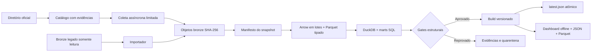

# Arquitetura e decisões

## Fluxo de dados

## ADR 001 — Execução single node e SQL vetorizado

O bronze de referência tem 169 envelopes e aproximadamente 146 MB. Um cluster Spark, Kafka ou um serviço de orquestração permanente introduziria custos operacionais sem benefício demonstrado nesse volume. DuckDB e Arrow atendem a escala observada, expõem SQL inspecionável e permitem limitar memória e paralelismo. O pipeline não depende de pandas.

Limite: um escritor por lake. Dashboards e consultas somente leitura podem consumir builds já concluídos. Para escalar, mantenha os contratos e substitua a camada de storage por um armazenamento de objetos com catálogo transacional e o executor por um motor distribuído, após medir volume, SLA e concorrência reais. Não há promessa de desempenho distribuído nesta implementação.

## ADR 002 — Objetos imutáveis e publicação por ponteiro

Bytes bronze são identificados pelo SHA-256 do conteúdo, não pelo nome da empresa ou da rota. Um endpoint pode compartilhar um objeto com outro sem sobrescrita. O manifesto vincula a captura aos objetos, metadados e páginas. A importação é somente leitura; os arquivos são copiados para o novo lake.

Checkpoints de uma coleta aberta são mutáveis. Um snapshot fechado é preservado: a retomada que precisa tentar falhas cria outra revisão. `latest-bronze.json` avança apenas ao final da coleta, e `latest.json` apenas ao final de um build aprovado. Escritas de JSON e dados JS usam arquivo temporário, flush, fsync e rename no mesmo volume. Os arquivos de um build são consumíveis apenas após `build.json` existir.

O lock `O_EXCL` impede escritores simultâneos. Ele não tem expiração automática: após queda abrupta, o operador verifica o PID antes de remover o lock. Não há garbage collection automática; nenhum objeto referenciado é apagado pelo pipeline.

## ADR 003 — Cache por conteúdo e versão de contrato

A chave silver usa o manifesto da captura e `TRANSFORM_VERSION`. Os dados são escritos em lotes de 4.096 linhas para sete schemas Arrow explícitos. O normalizador mantém em memória um envelope legado ou uma página da API por vez; o importador legado ainda precisa decodificar cada envelope inteiro. Não é streaming de um JSON arbitrariamente grande.

Uma marca de conclusão é gravada somente após fechar todos os escritores Parquet. Falhas deixam fragmentos não publicados, que podem ser reescritos pela próxima tentativa. Ao alterar normalização, contrato ou SQL de métricas, incremente `TRANSFORM_VERSION`; alterações somente visuais reconstroem o dashboard a partir do JSON existente.

Os marts Parquet são compactos, um arquivo por tabela por build, sem partições por endpoint ou CNPJ. O warehouse materializa as entradas uma vez para evitar reler centenas de fragmentos em cada agregação. DuckDB pode fazer spill para disco; o limite de memória aplica-se ao motor, não ao RSS total do processo Python.

## ADR 004 — Controle de pressão na origem

Uma fila de trabalho alimenta N corrotinas. Há semáforo por host e espaçamento por relógio monotônico. Retry aplica-se a erros de transporte e HTTP 408/429/5xx selecionados, não a 400/403. `Retry-After` aceita segundos ou data HTTP e tem teto configurado. Redirecionamentos não são seguidos automaticamente.

A coleta usa HTTPS verificado com truststore do SO. O código rejeita URLs com credenciais, esquema HTTP, portas não padrão e IPs literais privados. Não é um proxy público nem um serviço de URLs fornecidas por terceiros; a resolução DNS não oferece proteção contra DNS rebinding. O catálogo é um insumo operacional confiável e precisa ser revisado antes de executar em redes sensíveis.

Corpos de resposta são limitados após descompressão. Todas as páginas bem formadas são preservadas; respostas de erro também ficam no bronze. Repetição usa hash da página inteira para não confundir páginas cujo primeiro registro coincide. Um erro tardio preserva os dados anteriores e marca a captura como incompleta.

## ADR 005 — Separar integridade técnica e observação de mercado

Gates de integridade são bloqueantes: snapshot vazio, endpoint duplicado, registro fora de contrato e referência de taxa/tarifa sem produto. Falhas HTTP, endpoint vazio e taxa não comparável são observações de qualidade, não motivo para esconder todo o estudo. São reportadas e podem fazer o estado de qualidade ser `attention`.

O índice de qualidade é definido uma vez em SQL e usa componentes com denominadores explícitos. A interface não cria uma segunda definição do índice. Famílias não declaradas, declaradas vazias e publicadas têm estados distintos.

## ADR 006 — Artefato estático e cadeia de auditoria

O dashboard é HTML/CSS/JS local com um payload JS e JSON. Não há API analítica de rede, tracking, fontes externas ou CDN. Filtros locais atuam sobre marts já calculados; taxas, score e cobertura não são reinterpretados no navegador. Gráficos de composição e percentuais exibem agregações simples de dados prontos.

O artefato pode ser distribuído em uma pasta ou servido por uma infraestrutura estática corporativa. Autenticação, RBAC e SSO devem ser aplicados nessa infraestrutura quando necessários. Não se atribui à aplicação um controle de acesso que ela não implementa.

## Rastreabilidade

`endpoint_id` identifica grupo, CNPJ, família e URL. `source_sha` referencia os bytes originais. `entity_id` identifica o conteúdo normalizado; produtos aninhados incluem a identidade da sociedade. Taxas carregam `product_id` e `json_path`. Silver retém todas as evidências de origem; as tabelas do warehouse escolhem uma proveniência determinística para entidades deduplicadas.

O build registra versão de transformação, fingerprint, volume, duração, contagem por tabela, reutilização de cache, deduplicações e resultado dos gates. O JSON do dashboard registra a janela original da coleta separada da data de processamento.

## Revisão 1.2.0

O build verifica bronze e checksums de artefatos reutilizados. O cache silver usa conteúdo e identidade estável; metadados de captura são rematerializados. O destino estático tem lock próprio e releases imutáveis: o index de entrada avança somente após gerar todos os arquivos. Cada release tem seu próprio manual. Não se consome a antiga disposição de assets diretamente na raiz. No GitHub Pages, o deploy publica um único artefato construído e testado no CI.
